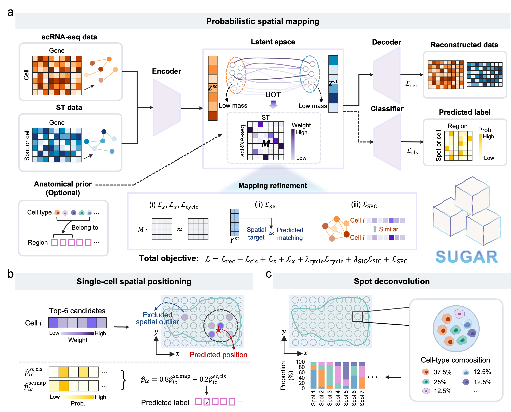

# SUGAR: probabilistic spatial mapping between heterogeneous single-cell RNA sequencing and spatial transcriptomics datasets

Spatial mapping links single-cell transcriptomes with their tissue context, enabling cellular states to be interpreted in relation to tissue architecture and local microenvironments. Existing approaches are naturally suited to settings in which the biological states represented in the query are sufficiently covered by the reference dataset. However, in practice, differences in profiling technology, tissue coverage, or developmental stage strongly weaken query-to-reference correspondence and complicate reliable cross-modal inference. Here, we develop SUGAR, a probabilistic framework for spatial mapping between heterogeneous single-cell RNA sequencing (scRNA-seq) and spatial transcriptomics (ST) datasets. SUGAR combines graph representation learning with unbalanced optimal transport to accommodate unmatched biological content, while leveraging transcriptional and spatial structure to inform correspondence assignments. The resulting transport matrix supports single-cell spatial positioning, label transfer and spot deconvolution. Across semi-simulated and real human and mouse datasets, SUGAR outperforms state-of-the-art methods in both cellular spatial-position inference and ST spot deconvolution. Notably, in challenging cross-region, anatomically mismatched, and cross-stage scenarios, SUGAR reduces inappropriate spatial assignments and accurately reconstructs tissue-scale organization, local cellular neighborhoods, and spatial patterns of cell-type distributions and gene expression. Overall, SUGAR provides a unified framework for bridging single-cell transcriptional profiles with tissue spatial organization across a broad range of applications.
